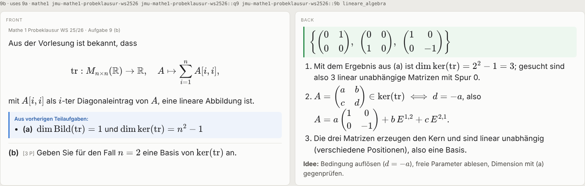
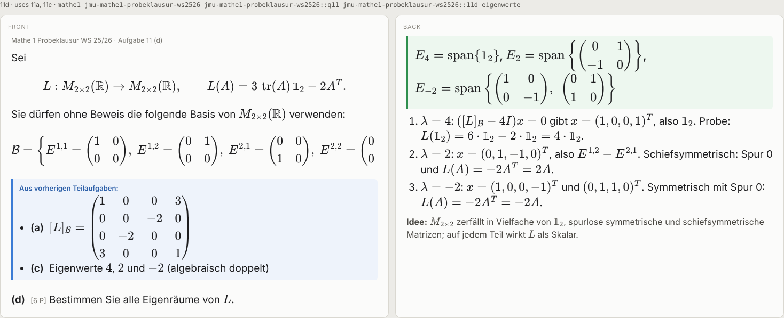

# Exam to Anki

**An agent skill that turns a past exam into verified Anki cards: one card per sub-question, where later parts carry the results of earlier parts so every card can be solved on its own.**

[](examples/probeklausur-mathe1)

Card 9 (b) of the bundled example. 9 (a) found the dimensions of the kernel and image of the trace, and 9 (b) gets them on its front, so the card works without card 9 (a) in sight.

---

Give an agent an old exam and ask for cards, and you usually get cards that are almost right: (c) needs the matrix from (a) and it isn't there, or it's there with a sign flipped; a sub-part is missing; one card gives away the next; the formulas show up as raw `$x^2$`. Anki doesn't forgive that, because you review those cards for months.

This skill has the agent solve the exam first, verify every computable answer with code, and write one structured `exam.json`. Scripts do the rest:

- **validate.py** refuses the deck if a part depends on a missing or later part, if a result it needs was never stated, if an answer leaks onto its own front, if the math won't render in Anki, or if the number of cards doesn't match the number of sub-questions counted at the start.
- **check_math.py** runs each part's verification code (sympy, brute force, substitution) and reports what passed.
- **build.py** assembles every front from the shared setup, the carried-over results and the task, then writes an `.apkg`, a plain-text import file and an HTML preview. Carried-over values are copied from the part that produced them, never retyped.

Everything runs on the Python standard library; sympy is optional and makes the checks much stronger.

## Quick start

```
npx skills add gildrb/skills --skill exam-to-anki -g -a claude-code
```

Then give the agent an exam:

```
/exam-to-anki here's last year's exam (PDF attached), one card per sub-question please
```

You get a `.apkg`. Double-click it, or use File → Import in Anki.

## Install

The skill is the `exam-to-anki` folder: a `SKILL.md` with its scripts, references and example. Use any of these:

| | Command |
|---|---|
| skills CLI, for you | `npx skills add gildrb/skills --skill exam-to-anki -g -a claude-code` |
| skills CLI, one project | `npx skills add gildrb/skills --skill exam-to-anki` |
| git | clone `gildrb/skills` and copy or symlink `exam-to-anki/` to `~/.claude/skills/exam-to-anki` |

Optional, for stronger checks: `pip install sympy`.

## Usage

The skill loads when you share an exam and ask for flashcards, Anki cards or a deck, in any language. A few habits help:

1. **Attach the real exam** (PDF, scan or photos). The agent reads formulas from the page images.
2. **Say if a chain matters to you**, e.g. "2 (b) needs the gcd from (a)". The agent decides what to carry, but you know your exam.
3. **Re-run freely.** Cards have stable IDs, so importing a rebuilt deck updates your existing cards and keeps their review history.

## What a card looks like

| Front | Back |
|---|---|
| Header: exam · question and part | **Answer** in a green box |
| Shared setup of the question, verbatim | Numbered steps (key equations only) |
| "From previous parts": the results this part uses, and only those | Key idea in one line |
| The task, verbatim, with its label and points | "Unverified" banner and `check` tag if the solution couldn't be verified |

Each card is tagged with the exam, the question, the part and any topic tags, so you can drill one topic across exams.

## Example

[`examples/probeklausur-mathe1`](examples/probeklausur-mathe1) is a German first-semester maths exam (linear algebra and number theory), turned into 34 cards. Nine of them carry earlier results, for example the matrix from 11 (a) and the eigenvalues from 11 (c) on the card for 11 (d):



The folder contains the `exam.json`, the built `.apkg`, the `.txt` import file and the HTML preview. Rebuild it with:

```
python3 scripts/build.py examples/probeklausur-mathe1/exam.json
```

## How it works

```
exam (PDF/scan) ──► agent reads pages as images, counts sub-questions
                ──► solves every part, maps which parts use which results
                ──► writes exam.json  (verbatim text, answers, steps, uses, result, check)
                ──► check_math.py     (every computable answer recomputed)
                ──► validate.py       (dependencies, leaks, math syntax, card count)
                ──► build.py          (.apkg + .txt + preview.html)
```

- [`SKILL.md`](SKILL.md) is what the agent reads: the workflow and the judgement calls.
- [`references/exam-json.md`](references/exam-json.md) is the file format.
- [`references/card-rules.md`](references/card-rules.md) covers what goes on a card and, most importantly, what to carry and what not to.
- [`references/edge-cases.md`](references/edge-cases.md) covers proofs, true/false lists, figures, scans, unsolvable parts and re-runs.
- [`evals/evals.json`](evals/evals.json) has test prompts and what a good result contains.

## Layout

```
exam-to-anki/
├── SKILL.md
├── scripts/
│   ├── examlib.py      shared model: loading, card rendering, tags, GUIDs
│   ├── validate.py     checks exam.json
│   ├── check_math.py   runs the verification code
│   ├── build.py        writes .apkg, .txt and preview.html
│   └── apkg.py         .apkg writer, standard library only
├── references/         exam-json.md, card-rules.md, edge-cases.md
├── examples/probeklausur-mathe1/
├── evals/evals.json
├── tests/test_scripts.py
└── assets/             README images
```

Run the tests with `python3 -m unittest discover -s tests` from this folder.

## Requirements

- An agent that can read PDFs or images and run Python (Claude Code, or Claude with code execution).
- Python 3.9+. No packages needed; `sympy` recommended for checks.
- A current Anki (desktop, AnkiDroid or AnkiMobile) to import the `.apkg`. The `.txt` fallback uses the `#guid column` header of Anki's text importer (Anki 2.1.55 and later).

## Limits

- The agent's solutions are only as good as the agent. Computable answers are checked by code; proofs are reviewed, not machine-checked. Anything uncertain is marked on the card and tagged `check`, never hidden.
- Card labels are translated for German and English; other languages get English labels (one dictionary in `scripts/examlib.py` to extend).
- The `.apkg` writer uses the legacy collection format that genanki also writes and that all current Anki versions import. In the environment where this skill was built, the package was checked structurally (SQLite integrity, notes, cards, decks) and by tests, not by importing it into a running Anki.

## License

MIT. See [LICENSE](LICENSE) and [THIRD_PARTY_NOTICES.md](THIRD_PARTY_NOTICES.md).
